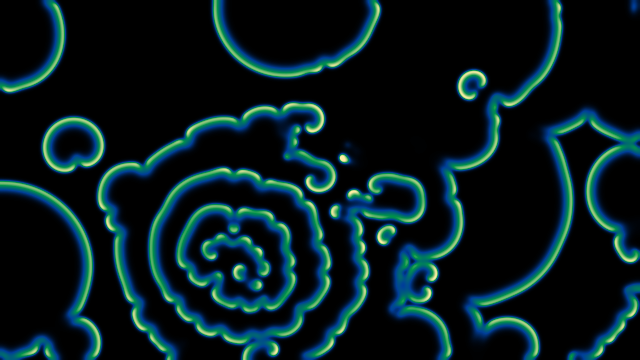

# Morphogen

**An engine of emergent pattern formation for the web.** Ten named models with their presets, sorted
into three categories by the mathematics of their rules, nine color ramps, one classic script with no
dependencies and no build step for the page that uses it, the simulation on the graphics processor with
the processor as fallback, and full keyboard, touch and screen-reader operation.

[**Live demo**](https://cs-training-systems.github.io/morphogen/) ·
[Quick start](#quick-start) · [Families and patterns](#families-and-patterns) · [Controls](#controls) ·
[API](#api) · [Palettes](#palettes) · [How it is built](#how-it-is-built) · [Accessibility](#accessibility) ·
[Forking and contributing](#forking-and-contributing) · [Citing](#citing-and-attribution) · [License](#license)




## Project map

Every item in the project, with its purpose, how deeply a session reads it, who may change it, and what triggers an update. Layer 1 is this map; Layer 3 is read in full at the start of every session; Layer 2 is read at overview depth as the task needs. Last revised 2026-10-15.

| Item | Path | Purpose | Layer | Authority | Update trigger |
|---|---|---|---|---|---|
| Working rules | `CLAUDE.md` | How Claude works in this project; loads itself | 3 | user only | a ruling promoted to it (an `adr-MC…` record) |
| This README | `README.md` | Public introduction, this map, the engine's documentation | 1 | user; Claude proposes | any change to the file set, or an `adr-MR…` record |
| Decision records | `docs/adr/` | One record per Decision or Mandate, Corrections inside them | 3 (ADR_README and the must-read list) | user approves every record | every consequential ruling |
| Record index | `docs/adr/ADR_INDEX.md` | Generated list of every record, newest first | 2 | generated by `tools/adr-index.js` | any write under `docs/adr/` |
| Status | `docs/STATUS.md` | Priorities, next action, session log: the resume point | 3 | Claude proposes, user approves | every session end |
| Pending decisions | `docs/PENDING.md` | Open questions with their options | 2 | Claude proposes | a question raised or settled |
| Known issues | `docs/KNOWN-ISSUES.md` | Defects and mismatches found, with status | 2 | Claude proposes | an issue found or fixed |
| Risks | `docs/RISKS.md` | What could go wrong, with mitigation | 2 | Claude proposes | a risk found or retired |
| Provenance | `docs/PROVENANCE.md` | Where models, media and documents come from | 2 | Claude proposes | a new model, medium or borrowed idea |
| Releases | `docs/RELEASES.md` | Every version, tag and commit | 2 | user approves | every tag |
| Changelog | `CHANGELOG.md` | Keep a Changelog, Unreleased on top | 2 | Claude proposes | every behaviour change |
| Contributing | `CONTRIBUTING.md` | Conventions, layout, versioning policy | 2 | user approves | a convention changes |
| Citation | `CITATION.cff` | Citation metadata and the model sources | 2 | user approves | a release or a new model |
| Licence | `LICENSE` | MIT | 2 | user only | never expected |
| Visual taxonomy | `docs/taxonomy/user-friendly-taxonomy.md` | The visual-type catalog Morphogen is built from, with its critiques and the governing response | 2 (in full when working on it) | user; Claude proposes | priority 2 in STATUS |
| Engine source | `src/` | One file per model or group; the registry, backends, field, controls, presets | 2 | Claude proposes | engine work |
| Tools | `tools/` | Build, media renderer, capture page, record index | 2 | Claude proposes | tooling work |
| Tests | `tests/` | The fade verifier; `npm test` also checks the record index | 2 | Claude proposes | engine work |
| Demo page | `index.html`, `demo.css`, `banner.js` | The live demo with the full control set | 2 | Claude proposes | a model or control changes |
| Shipped script and stylesheet | `morphogen.js`, `morphogen.css` | What a host page copies; the script is built from `src/` | 2 | `morphogen.js` generated by `tools/build.js` | every build |
| Media | `docs/media/` | README stills, GIFs and banner captures | 2 | generated by `tools/render-media.js` and `tools/capture.html` | a preset changes |
| Package | `package.json` | Name, version, scripts | 2 | user approves a version | a script or the version changes |
| Editor conventions | `.editorconfig` | Indent, line endings, charset, copied from cs-web-folio | 2 | user approves | never expected |
| Claude Code settings | `.claude/settings.json` | Ask before commit, tag, push; deny edits to CLAUDE.md; the record-index hook | 2 | user approves | a rule or hook changes |
| Ignore list | `.gitignore` | Keeps `temp/` out of every commit | 2 | user approves | a folder or file is excluded from the repository |
| Scratch space | `temp/` | The shared scratch space of the user and Claude, and where proposed edits wait for approval; not tracked; emptied by the user | none | user | never; its contents are not the map's concern |
| Morphospaces Atlas | `C:\dev\morphospaces-atlas` (separate repository) | The technical generator library and classification scheme; priority 1 in STATUS | external | its own records | its own |
| n-cell-tessellata | `C:\dev\n-cell-tessellata` (separate repository) | Non-square-cell 1-D and 2-D automata, to be integrated into Morphogen | external | its own records | its own |
| cs-web-folio | `C:\dev\cs-web-folio` (separate repository) | The site that consumes Morphogen as a dependency; priority 4 in STATUS | external | its own records | its own |
| Presets catalog | `docs/catalog/presets.md` (planned) | Every preset's configuration, generated from the presets data file | planned | generated | priority 3 in STATUS |


## What it is

Morphogen runs models of self-organization on a canvas, in the page, at the finest grid the visitor's
machine can animate without dropping frames, and shows the result through one visual language: a
four-color ramp over a smooth field, with every front leaving a trail that fades down the ramp. The
word is Alan Turing's, for the chemicals he proposed in 1952 as the agents of living form; read as
*morphogenesis*, the generation of form, it names the whole engine.

The models are written from their published equations and rules, each cited in the source beside its
code, with no borrowed code. Every model is placed in one of three categories by the mathematics of its
rule as written, never by how it looks:

- **Stepwise** — deterministic, discrete time: every bounded stretch of time holds finitely many steps.
  Reiter's snow crystal, the cellular automaton (Wolfram's rules in 1-D, Life-like rules in 2-D), Lenia,
  the lattice-Boltzmann fluid, the cyclic automaton.
- **Flowing** — deterministic, continuous time: a differential equation, integrated in steps only to
  compute it. Gray–Scott, the complex Ginzburg–Landau equation.
- **Chance-driven** — the rule itself contains a probability law. Dielectric breakdown, the Potts model,
  the forest fire.

Randomness in a seed does not make a model chance-driven; the seed value in the controls makes every run
repeatable. Where a model's look suggests another category (a stepwise rule that reproduces a continuous
fluid, a continuous equation drawn frame by frame), that is the computation, not the model, and the
model's note on the demo says so.

## Quick start

Copy `morphogen.js` and `morphogen.css` into your site and write:

```html
<link rel="stylesheet" href="morphogen.css">
<div data-rd-scope>
  <canvas data-morphogen data-preset="malachite" data-palette="canopy"
          role="img" aria-label="An emergent-pattern simulation. Click and drag on it to seed a pattern."></canvas>
</div>
<script src="morphogen.js" defer></script>
```

That is the whole integration: one stylesheet, one canvas, one script tag. The script defines a
single global, `Morphogen`, mounts every `canvas[data-morphogen]` when the document is ready, and
binds any controls you place inside the same `[data-rd-scope]` container by their `data-rd` role
(next sections). `index.html` in this repository is the full control set; copy what you need.

As a dependency, pinned to a release:

```
npm install github:cs-training-systems/morphogen#v0.1.0
```

Morphogen is in major version zero: the model set and the controls are still changing, and 1.0.0
is the release in which they are signed off and the public interface is declared stable.

The package ships the script and the stylesheet only. Serve them from your own origin; nothing is
fetched at run time, and the script makes no network request of any kind.

### Canvas attributes

| Attribute | Meaning | Default |
|---|---|---|
| `data-preset` | a preset id (see [Families and patterns](#families-and-patterns)); sets the model, its parameters and its seeding | `malachite` |
| `data-model` · `data-feed` · `data-kill` | a model id with parameter overrides, for a canvas without a preset | Gray–Scott 0.010 · 0.035 |
| `data-palette` | a palette id (see [Palettes](#palettes)) | `canopy` |
| `data-time-scale` | speed; steps per frame = 8 × this | 0.75 |
| `data-step-scale` | a further multiplier on the steps per frame (a preset may slow itself) | 1 |
| `data-dscale` | Gray–Scott diffusion scale: both diffusion rates multiplied (sets the spacing between fronts) | 1 |
| `data-hover` | `on`: the pointer paints on hover alone; otherwise only while a button is held | off |
| `data-quality` | the resolution: a ladder width (240 … 1600 cells across) or `auto` (up to the display, adaptive) | `320` |
| `data-gpu` | `off` to force the processor path | on |
| `data-brush` | the pointer's mark as a share of the field's height | 0.03 |
| `data-fade-start` · `data-fade-end` | seconds after the pointer leaves at which a Gray–Scott pattern winds down and dies; unset = never | unset |

## Categories, models and presets

A **tile** is a named model. A **preset** is one of its recipes: parameter values, seeding, speed,
brush, palette and resolution, chosen so a regime shows at its best, with every slider centered on the
preset's value. The demo's category row swaps the tile set; a tile selects its first preset; the chips
under the mode line switch presets. The field clears to black and nothing appears until the visitor
paints or presses Seed, which starts the pattern at the center (later presses add one point at random).
The model's note stays on screen while settings change.

| Category | Model | Presets |
|---|---|---|
| Flowing | Gray–Scott | Malachite, Meandric, Swarm, Xylem, Turbulence, Mitosis, Phyllotaxis, Vortex |
| Flowing | Ginzburg–Landau | Antispiral, Defect turbulence |
| Stepwise | Reiter snow crystal | Frost |
| Stepwise | Cellular automaton | Rule 30, Rule 110, Rule 90 (1-D); Life, HighLife, Day and Night, Seeds, Brian's Brain (2-D) |
| Stepwise | Lenia | Orbium |
| Stepwise | Lattice Boltzmann | Wake |
| Stepwise | Cyclic automaton | Rotor |
| Chance-driven | Dielectric breakdown | Lightning, Aggregation (η = 1, diffusion-limited aggregation) |
| Chance-driven | Potts model | Grain growth, Ising at criticality |
| Chance-driven | Forest fire | Wildfire |

### The flowing models

The Gray–Scott presets (stills: `docs/media/preset-<id>.png`): Malachite, feed 0.008 · kill 0.031,
concentric banded fronts from a pacemaker; Meandric, 0.026 · 0.055, labyrinthine stripes; Swarm, 0.013 ·
0.054, a crowd of travelling, dividing spots; Xylem, 0.039 · 0.058, a sheet opening into a pore lattice;
Turbulence, 0.025 · 0.050, spatiotemporal chaos; Mitosis, 0.037 · 0.065, self-replicating spots; Phyllotaxis,
0.030 · 0.062, a sunflower head grown one spot at a time on the golden angle; Vortex, 0.008 · 0.039 at
diffusion × 3.2, spiral waves from broken fronts, with a stir of five points and four curved slashes on
every Seed press and click.

**Gray–Scott** (Gray & Scott 1984; Pearson 1993), per step, with the 3×3 Laplacian (center −1,
edges 0.2, corners 0.05) and dt = 1:

```
U' = U + (Du·∇²U − U·V² + f·(1 − U))      Du = 0.2097
V' = V + (Dv·∇²V + U·V² − (f + k)·V)      Dv = 0.105
```

**The complex Ginzburg–Landau equation** (Aranson & Kramer 2002), the normal form of every
reaction–diffusion system just past the onset of oscillation: one complex amplitude A,
`∂A/∂t = A + (1 + iα)∇²A − (1 + iβ)|A|²A`, α the linear and β the nonlinear dispersion (Aranson &
Kramer's b and c). Plane waves are stable while `1 + αβ > 0`; a phase singularity is a spiral wave,
and near onset with α > β its phase velocity turns inward (Nicola, Brusch & Bär 2004). Explicit Euler on the 9-point Laplacian
(spacing 0.6, step 0.03). The field is dark until seeded; a disc of random phase invades it as a front.

The phase-field dendrite of Kobayashi (1993) remains in the registry as the model `dendrite`.

### The stepwise and chance-driven models

Reiter's snow crystal (2005): vapor β 0.30, addition γ 0.001, diffusion α 1, a six-fold dendrite grown cell
by cell on a hexagonal lattice, permanent, crystals growing together where they meet, the brush a void with
one pinpoint nucleus at its centre. The cellular automaton: in 1-D a Wolfram rule number (Rule 30, 110, 90
as presets), in 2-D a Life-like B/S/C rule (Life B3/S23, HighLife B36/S23, Day and Night B3678/S34678,
Seeds B2/S, Brian's Brain B2/S/C3). Lenia (Chan 2019): growth centre μ 0.136, width σ 0.011, smooth
self-propelling creatures from a patch of soup. The lattice-Boltzmann fluid (D2Q9, BGK): inlet speed 0.130,
viscosity 0.02, a von Kármán vortex street behind an obstacle you paint. The cyclic automaton (Griffeath):
5 states, threshold 2, spiral rotors self-organizing from noise. Dielectric breakdown (Niemeyer, Pietronero
and Wiesmann 1984): exponent η 2.4 for lightning, η 1 for diffusion-limited aggregation. The Potts model:
12 states at temperature 0.6 for grain growth; q = 2 near its critical temperature for the Ising critical
fog. The forest fire (Drossel and Schwabl 1992): growth 0.005, lightning 0.00002, fractal fire fronts
through a self-organizing forest. The falling-sand model and the Gravner–Griffeath crystal remain in the
registry without tiles (`sand`, `snow`), as do the phase-field dendrite (`dendrite`) and the abelian
sandpile (`sandpile`).

Each model's rule is stated in the demo's note for its tile, with its law in MathML, and in the comment
at the head of its source file.

The snow crystal is not a reaction–diffusion system — it has no local chemistry acting everywhere,
only transport and a sharp interface that advances where mass arrives, a discrete Stefan problem kin
to diffusion-limited aggregation — which is why it lives in this family. Reiter's rule: a cell that is
ice, or touches ice, holds its water and gains γ each step; everywhere else the water diffuses toward
the six-neighbour mean, u' = u + (α/2)(ū − u); a cell freezes at 1. The Gravner–Griffeath crystal (2008)
remains in the registry as the model `snow`, the abelian sandpile as `sandpile`.

## Controls

Any element inside the `[data-rd-scope]` container with one of these roles is wired automatically.
All of them are optional.

| `data-rd` | Element | What it does |
|---|---|---|
| `category` | `<button data-rd-id="stepwise|flowing|chance">` | Shows that category's tiles and selects its default tile; `aria-pressed` tracks the active one; `data-rd-default` marks the initial category |
| `tile` | `<button data-rd-id="<tile id>">`, optionally holding a `thumb` canvas | Selects a model and its first preset, clearing the field (nothing is seeded until the visitor paints or presses Seed); `aria-pressed` tracks the active one; `data-rd-default` marks a category's initial tile |
| `chips` | an empty container | Receives one `chip` button per preset of the active tile; a chip applies its preset; hidden when a tile has one preset |
| `preset-line` | any element | Receives the active preset's name, or "Custom settings", with a note when the preset's slider box is provisional |
| `thumb` | `<canvas aria-hidden="true">` inside a tile button | Filled with a thumbnail of that tile's first preset, computed by the engine itself after the page has loaded; repainted when the colors change |
| `note` | any element with `data-rd-for="<tile id>"` | Shown while that model is active and kept while settings change |
| `p1-range` / `p1-number` / `p1-unit` (or `feed-*`) | `<input type="range">` / `<input type="number">` / any element | The model's first parameter; the pair tracks itself; its label, unit, range and step follow the model and the preset |
| `p2-range` / `p2-number` / `p2-unit` (or `kill-*`) | as above | The second parameter |
| `p3-range` / `p3-number` / `p3-unit` | as above, inside a `.rd__param` row | A third parameter; the row is hidden while the model declares fewer |
| `model-controls` · `dimension` · `rule` · `rule-label` | a group · `<select>` (1 or 2) · `<input type="text">` · any element | The cellular automaton's own controls: the lattice dimension, and the rule as a Wolfram number (1-D) or a B/S/C string (2-D); hidden for models that declare no controls |
| `seed-value` · `seed-reroll` | `<input type="number">` · `<button>` | The seed value every random choice is drawn from (0 to 999999); setting it clears the field; the button draws a new one |
| `scale-range` / `scale-number` | as above | Speed, centered on the preset's own speed, a fifth to five times it: the track is logarithmic so the preset sits mid-track, and the real value is read from the number box, the labels under the track (`speed-ticks`) and the slider's value text |
| `pause` | `<button>` | Pause / Play; its text and label follow the state |
| `reset` | `<button>` | Clears the field to the ground color |
| `seed` | `<button>` | Starts the pattern at the center; later presses place one random point (a preset may run its own opening on every press) |
| `colors-toggle` · `colors-menu` | `<button aria-expanded aria-controls>` · `<fieldset>` | A drop-down of `palette-option` radios; a choice, Escape, or focus leaving closes it |
| `palette-option` | `<input type="radio" value="<palette id>" data-rd-name="…">` | Color ramp by id |
| `motion-check` · `motion` | `<input type="checkbox">` · `<button aria-pressed>` | The accessibility toggle, reduced motion on or off (see [Accessibility](#accessibility)) |
| `hover-check` · `hover` | `<input type="checkbox">` · `<button aria-pressed>` | Hover mode: the pointer paints on hover alone; off (the default) it paints only while a button is held, and a touch always paints |
| `mode` | any element | Receives "FAMILY: PATTERN" in capitals |
| `loading` | any element with `hidden` | Shown while a reduced-motion still is computed |
| `quality` | `<select>` | The resolution: a ladder width (240 … 1600) or `auto`; see [Resolution](#how-it-is-built) |
| `brush` | `<select>` | Brush width: the pointer's mark as a share of the field's height. On a crystal field (Frost) the brush is a **void** of that width wiped back to vapour, with one pinpoint nucleus at its centre, dropped once a second while the stroke lasts |
| `measure` | any element | Receives the lattice in use, the frame rate and the brush, twice a second |
| `state` | any element | Receives a visible one-line state: family, pattern, colors, animating / paused / reduced motion |
| `status` | any element with `aria-live="polite"` | Receives a short plain-text status on every change |
| `steps` | `<select>` | Base steps per frame |

## API

```js
const field = Morphogen.mount(canvas, options);   // or Morphogen.get(canvas) after auto-mount
field.setModel("gray-scott", { feed: 0.029, kill: 0.057 });   // any model in Morphogen.models, with parameter overrides
field.setParams(0.029, 0.057).setTimeScale(1).setPalette("aurora");   // the two user parameters, by position
field.setParam("kappa2", 10);                                // any parameter by key, the model's extras included
field.setDiffusionScale(3.2);                                // Gray–Scott: both diffusion rates × 3.2 (Vortex uses this)
field.setHover(true);                                        // paint on hover alone; false (default) = click and drag
field.seedSpec({ type: "spiral", n: 21, r: 3 });            // "spiral" | "strokes" | "discs" | "grow" | "pacemaker" | "center" | "fill" | "stir"
field.setFirstMark(spec, every);                             // the seeding the first mark runs (every: on every Seed press and click)
field.pause(); field.play(); field.clear();
field.on((type, f) => { /* "model" "params" "palette" "pause" "play" "clear" "seed" "quiet" "quality" "motion" "hover" */ });
field.quality();                                             // { auto, cap, level, width, height, lattice, grid, radius, ms, fps, steps, backend }
field.setQuality(640); field.setQuality("auto");             // a ladder width, or adaptive up to the display
field.setReducedMotion(true);                                // the chronogram still (see Accessibility)
field.tick();                                                // one frame of work, no scheduling (tests)
field.engine();                                              // the backend (diagnostics)
field.destroy();
```

`Morphogen.models`, `Morphogen.categories`, `Morphogen.tiles`, `Morphogen.presets` and
`Morphogen.palettes` expose the built-in sets (`Morphogen.families` is an alias of the categories);
`field.setSeed(n)`, `field.seedValue()` and `field.random()` are the seed value and its stream;
`Morphogen.parseLifeRule("B3/S23")` and `Morphogen.lifeRuleString(b, s, c)` convert the 2-D rule;
`Morphogen.defineModel(definition)` registers a model (see `src/`);
`Morphogen.renderThumb(preset, { width, height, steps }, useGpu)` renders a preset offline.
`ReactionDiffusion` is kept as an alias of the global for pages written against 1.x.

## Palettes

Each ramp is four colors: the ground (black, so a decaying edge fades into it), a trail, a body and a
front, mapped over the field's display scalar. The names are one word, scientific, and the colors are
the brand set.

| Id | Colors |
|---|---|
| `canopy` (default) | black · deep blue `#003E99` · green `#009149` · buff `#FEEEA3` |
| `aurora` | black · green `#009149` · violet `#7728A8` · white |
| `spectrum` | black · deep blue `#003E99` · red `#D30011` · white |
| `neon` | black · red `#D30011` · green `#009149` · white |
| `accretion` | black · deep blue `#003E99` · orange `#FD5F00` · white |
| `physarum` | black · deep blue `#003E99` · yellow `#FDD100` · white |
| `cherenkov` | black · violet `#7728A8` · cyan `#0095DA` · white |
| `orodruin` | black · red `#D30011` · orange `#FD5F00` · yellow `#FDD100` |
| `coastal` | black · deep blue `#003E99` · cyan `#0095DA` · buff `#FEEEA3` |

Your own ramp: `field.setPalette(["#000000", "#102040", "#2080c0", "#ffffff"])`.

## How it is built

**One mathematics per model, two engines.** On WebGL2 with float render targets (every current
desktop and mobile browser) every model runs on the graphics processor: one fragment-shader pass per
step and pass, over a ping-pong pair of float textures (one to three textures per state, for models
with up to twelve numbers per cell), seeding and resampling as passes too. Otherwise, and in Node for
the tests and the media renderer, the processor path runs the identical update on typed arrays. A
model declares both steps, written from the same rule.

**The model registry.** A model is a plain object: its family, its lattice (square or hexagonal),
its state channels, its two user parameters with names and ranges, its fixed extras, its passes, its
seeding, its display mapping, its liveness test, its glow and its resolution policy. The core knows
no model. `src/` holds one file per model or group; `tools/build.js` concatenates them into the
shipped script.

**The glow stage.** Every model's display scalar, before the palette, passes through a small
Gaussian blur and a persistence field that each frame takes the maximum of the blurred scalar and its
own decayed self. The reaction–diffusion field is smooth and lingering by nature; the glow gives the
automata the same language, so edges are never seen and every moving front leaves a trail that fades
down the ramp. Each model sets its blur and decay.

**Resolution.** The ladder runs 240 … 1600 cells across; the height follows the frame's own aspect
ratio, and on every tile a lower rung means bigger features and a higher one finer. The grid is the
chosen rung; on Automatic the engine adapts beneath the display: from 400 wide, it climbs while its
own compute time stays under 8 ms and frames arrive on time, steps down above 12 ms or when frames
arrive late, holds a second after each change, and resamples the running state so a change is
invisible. A smooth field (Gray–Scott, Ginzburg–Landau, Lenia, the fluid) is shown by the browser's
bilinear upscaling; a square-lattice automaton's glow blur follows its cell; a hexagonal lattice (the
crystals) is drawn on the canvas's own device pixels by blending each pixel's three nearest cells, the
lattice triangle that holds it, so no cell is ever seen, and on Automatic its lattice is the screen's
pixels themselves, one cell per pixel. A model may still declare *pixels* to run on device pixels
(capped at 2048 across) regardless of the rung.

**Seeding and speed.** A preset's seeding is geometry in the field's own pixels: Vogel's spiral,
strokes, discs, a growing head placed one spot every few frames on the golden angle until it leaves
the frame, a pacemaker that fires again and again, the whole field, or a timed stir of points and
curved slashes. Time scale 1 is 8 steps per frame; the default 0.75 is 6; a preset may slow itself
(`stepScale`) and set its own speed, on which the slider is centered.

**Fade window.** Off by default: patterns run until Reset. With `fadeStart`/`fadeEnd` set, a
Gray–Scott pattern's autocatalytic gain winds down smoothly between those times after the pointer
leaves. `npm test` runs `tests/verify-fade.js`, which proves this per preset in Node with an
injected clock.

**Thumbnails** are computed by the engine itself after the page has loaded, on the graphics processor
through an offscreen canvas (milliseconds each, no main-thread cost), their display scalars kept so a
palette change repaints them.

## Accessibility

- The canvas is `role="img"` with a text alternative; the pointer interaction is decorative, so
  everything is operable without a pointer: families, presets, Seed, Pause and Reset are real
  buttons; the parameters and speed are native range and number inputs with labels.
- Painting needs a held button by default, so an unintended pass of the pointer changes nothing;
  Hover mode is an opt-in toggle. A touch always paints while the finger is on the field, and the
  field never takes the whole width of a phone, so a thumb beside it still scrolls the page.
- **Photosensitivity.** Some regimes flicker and pulse. The demo carries a notice before the field,
  and Reduced motion replaces the animation with a still; a host page should carry the same notice
  in reading order before the field.
- Every change is announced through a polite live region; state is never conveyed by color alone
  (the active family, preset and color are marked by border and mark).
- **Reduced motion** is an accessibility mode, for people for whom moving content causes
  vestibular symptoms, and it starts on when the operating system asks for it
  (`prefers-reduced-motion: reduce`); the page can also expose it as a toggle. By design it replaces
  the animation with one still frame that is substantially equivalent to the animation for the
  current settings: a chronogram whose left edge is the seed state, whose right edge is the pattern
  at full development, and whose middle is the transition, recomputed for any change of pattern,
  parameters or colors. The color menu's animation is removed under the same preference.
- A visible state line always says which family, pattern and colors are engaged and whether the
  field is animating, paused or in reduced motion, and the active pattern's note sits beneath it.
- The frame, corner brackets, thumbnails and swatches keep their borders under Windows high
  contrast (`forced-colors: active`).

## Browser support

Any current browser. The graphics-processor path needs WebGL2 with the `EXT_color_buffer_float`
extension, which every current desktop and mobile browser provides; without it the processor path
takes over with the same mathematics at a coarser grid. Everything else is Canvas 2D,
`requestAnimationFrame`, pointer events, `matchMedia` and typed arrays. The demo's notes use inline
MathML, which every current browser renders natively.

## Forking and contributing

Fork on GitHub, clone your fork, and open `index.html` from any local web server; there is nothing
to install. Edit `src/`, run `node tools/build.js`, run `npm test`. See
[CONTRIBUTING.md](CONTRIBUTING.md) for the conventions that keep the project small, and
[CHANGELOG.md](CHANGELOG.md) for what changed when.

## Citing and attribution

Morphogen is MIT-licensed, so you may use, copy, modify and redistribute it, including
commercially, provided the copyright and license notice stay with it. If you show it or build on
it, a credit line is appreciated:

> Morphogen, © 2026 Christopher A. Stamplis, MIT License — https://github.com/cs-training-systems/morphogen

For publications, use GitHub's **Cite this repository** button (the metadata is in
[CITATION.cff](CITATION.cff)) and cite the model's sources, which are listed there and at the head of
each model's source file: Gray & Scott (1984) and Pearson (1993) for Gray–Scott; Aranson & Kramer
(2002) and Nicola, Brusch & Bär (2004) for the complex Ginzburg–Landau equation; Kobayashi (1993) for
the dendrite; Reiter (2005) and Gravner & Griffeath (2008) for the snow crystals; Chan (2019) for
Lenia; Fisch, Gravner & Griffeath (1991) for the cyclic automaton; Niemeyer, Pietronero & Wiesmann
(1984) for dielectric breakdown; Toffoli & Margolus (1987) for falling sand; Wolfram (1983) for the
elementary automaton; Drossel & Schwabl (1992) for the forest fire; Anderson, Srolovitz, Grest & Sahni
(1984) for grain growth; Qian, d'Humières & Lallemand (1992) for the lattice-Boltzmann method.

Morphogen is written from the published equations and rules with no borrowed code. Visual
inspiration: [pmneila/jsexp](https://github.com/pmneila/jsexp) (BSD-3-Clause).

## License

MIT © 2026 Christopher A. Stamplis. The full terms are in [LICENSE](LICENSE).
